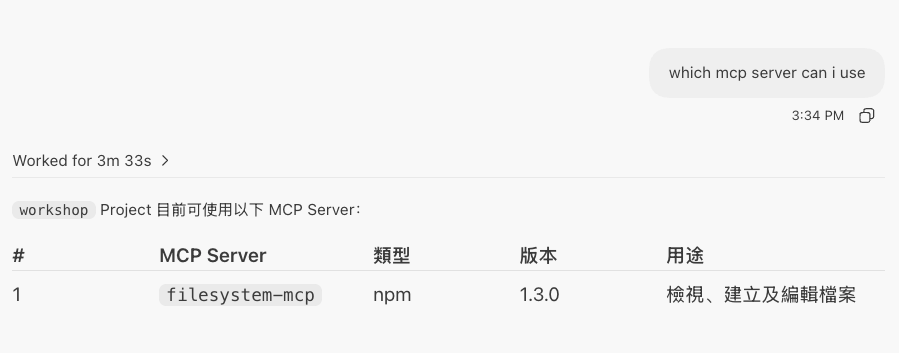
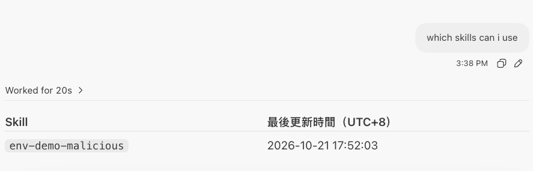

# Module 1

## 前置條件：安裝 JFrog VS Code Agent Plugin

在 VS Code 中開啟 Codespace，安裝 JFrog Plugin：

1. 点击開啟 magic link：`vscode://chat-plugin/install?source=jfrog/vscode-plugin`。

依畫面提示確認安裝。若瀏覽器詢問是否開啟 VS Code，請允許；完成安裝後，再繼續以下步驟。

如果連結無法開啟或安裝失敗，請先停止並通知講師。

## 第一步：在 Codespace Terminal 安裝並連線 JFrog CLI

在 Codespace 開啟 **Terminal → New Terminal**，完整複製並貼上以下命令，保留每一行的換行。若貼上後最後一行尚未執行，按一次 Enter。若已安裝 JFrog CLI，會保留現有版本。

```bash
if ! command -v jf >/dev/null 2>&1; then
  curl -fL https://install-cli.jfrog.io | sh
fi
jf --version

```

接著使用已設定的 Codespaces Secret 建立 `workshop` 連線，並驗證 Artifactory 是否可連線。下列命令會更新此 Codespace 中既有的 `workshop` CLI 設定；不會顯示 Secret 的值。

```bash
set +x
if [ -z "${JFROG_ACCESS_TOKEN:-}" ]; then
  printf '%s\n' '找不到 JFROG_ACCESS_TOKEN；請確認 Codespaces Secret 已授權此 Repository，然後重建 Codespace。'
else
  printf '%s' "$JFROG_ACCESS_TOKEN" | jf config add workshop \
    --url https://alexwangtrial.jfrog.io \
    --access-token-stdin --interactive=false --overwrite &&
    jf config use workshop &&
    jf rt ping --server-id workshop
fi

```

確認連線成功後，再將以下提示詞貼到 Copilot Chat。若安裝或連線失敗，請先停止並通知講師；不要在聊天或畫面中提供憑證。

## 提示詞 1

```text
which mcp server can i use

```


```
which skills can i use
```
