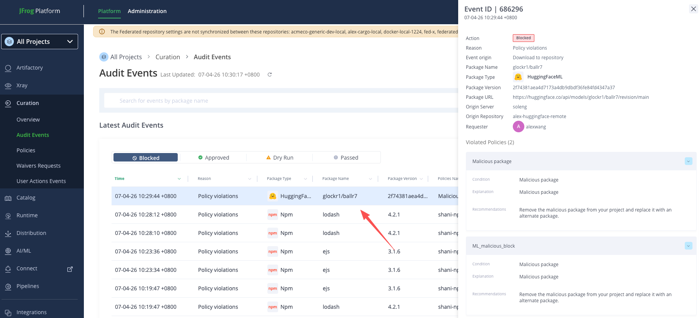

# 模組 2：Hugging Face 模型掃描、Curation 與 Shadow AI

本模組可獨立進行，使用 `workshop` 實例、`workshop-pypi`、`workshop-huggingfaceml` 與 Hugging Face 模型治理案例。預設模型 ID 只是候選；實際下載前必須由講師明確核准。建議時間 60 分鐘。

## Quick Start：GitHub Codespaces

開啟 Copilot Chat 的 **Local Agent** 並輸入：

```text
/module2
```

Copilot 只會呼叫 `bash scripts/run-module.sh 2`，自動檢查 `workshop`、綁定 `workshop-pypi` 並對兩個模型候選執行 Dry Run。它不會下載、載入或執行模型；實際下載仍需要講師對精確模型與 Revision 的明確核准。

## 來源範例對應

| 原始內容 | 本模組用法 | 安全調整 |
|---|---|---|
| `download_model.py` | `model-client/download_model.py` | 移除 SSL 繞過、改用參數、要求 JFrog Endpoint |
| `uplad_model.py` | `model-client/upload_model.py` | 修正名稱、要求明確 Endpoint/來源/目的地、支援 Dry Run |
| `requirements.txt` | `model-client/requirements.txt` | 移除本案例不需要的 `torch` |
| `Block-model.png` | `assets/Block-model.png` | 保留為 Curation Audit 教學證據 |
| `glockr1/ballr7` | 預設 Block 候選 | 每次開課前重新驗證，不宣稱永久會被阻擋 |

原始程式的 `HF_HUB_DISABLE_SSL_VERIFICATION=1` 不會沿用；企業 Workshop 不應停用 TLS 驗證。原始的 `Qwen/Qwen3.5-35B-A3B` 體積較大，也不設為學員預設下載。

## 完成標準

- 模型流量只走指定的 JFrog Hugging Face Virtual Repository。
- 安全模型能下載；測試模型被 Curation 阻擋。
- 學員能讀懂 Curation Audit Event。
- 能區分 Curation Block、惡意模型掃描結果與 Shadow AI 決策。
- 不執行、不載入未知模型。

## 前置條件

本模組不依賴套件、Skill 或 MCP 模組。需要：

- JFrog SaaS 的 Artifactory、Xray、Curation、AI Catalog/Shadow AI 與 Hugging Face Repository 支援。
- PyPI Virtual Repository `workshop-pypi`，用來安裝 `huggingface_hub`。
- Hugging Face Virtual Repository `workshop-huggingfaceml`，作為唯一模型 Endpoint；它包含 `workshop-huggingfaceml-local` 與 `workshop-huggingfaceml-remote`。
- Python 3、JFrog CLI、Codex 與 JFrog Plugin。
- 管理員已確認 Skill/模型相關 Beta 與 entitlement。

## 管理員設定

1. 確認 `workshop-pypi` 與 `workshop-huggingfaceml` 已納入 Project `workshop`。
2. 在 Artifactory **Set Me Up** 確認 `HF_ENDPOINT` 為 `https://alexwangtrial.jfrog.io/artifactory/api/huggingfaceml/workshop-huggingfaceml`。
3. 將 Repository 納入 Xray Indexing。
4. 啟用 Curation 的惡意模型 Block 政策，確認不是 Dry Run。
5. 以學員角色預驗證：
   - `openai-community/gpt2` 或另一個小型核准模型可取得。
   - `glockr1/ballr7` 目前會被阻擋；若情資已變動，改用 JFrog 官方當期測試資產。
6. 確認 AI Catalog/Shadow AI 能看到測試活動與決策。

## 學員設定

以下命令保留作為本機備援與講師排錯參考；Codespaces 學員只需使用 `/module2`。

```bash
cp modules/02-model-governance/module.env.example \
  modules/02-model-governance/.env.module
jf c use workshop
jf rt ping --server-id workshop
jf setup pip \
  --server-id workshop \
  --repo workshop-pypi \
  --project workshop
python3 -m venv modules/02-model-governance/.venv
source modules/02-model-governance/.venv/bin/activate
python3 -m pip install -r modules/02-model-governance/model-client/requirements.txt
```

`pip` 必須透過講師指定的 Artifactory；不要加入公用 `--index-url`。將 Token 放在目前 Shell 的受保護環境，不寫入 `.env.module`：

```bash
export HF_ENDPOINT='https://alexwangtrial.jfrog.io/artifactory/api/huggingfaceml/workshop-huggingfaceml'
export JFROG_ACCESS_TOKEN='<以安全方式取得的短期 Token>'
```

投影或分享終端前先清除敏感輸出。

獨立驗證 Codex/JFrog 整合：

```bash
jf rt ping --server-id workshop
codex plugin list
codex mcp list
```

在 Codex `/skills` 執行 `jfrog-init`，指定同一個 Server ID 與 Project；在 `/hooks` 確認 JFrog Hook 已信任。只做唯讀盤點時，不需要先完成其他 Workshop 模組。

## 實作 A：Dry Run

```bash
python3 modules/02-model-governance/model-client/download_model.py \
  --model openai-community/gpt2 \
  --revision main \
  --local-dir model_cache/gpt2 \
  --dry-run
```

確認輸出只有 Endpoint、模型、Revision、目的地與 `token_configured=yes/no`，不顯示 Token 本身。

## 實作 B：安全模型下載

由講師明確核准模型 ID、Revision、容量與授權後才可移除 `--dry-run`。若尚未核准，停在 Dry Run：

```bash
python3 modules/02-model-governance/model-client/download_model.py \
  --model <WORKSHOP_SAFE_MODEL> \
  --revision <MODEL_REVISION> \
  --local-dir model_cache/safe-model
```

預期：模型只從 `HF_ENDPOINT` 取得。記錄模型 ID、Revision/Commit、檔案雜湊、Repository 與 Curation 結果。

## 實作 C：惡意模型阻擋

```bash
python3 modules/02-model-governance/model-client/download_model.py \
  --model glockr1/ballr7 \
  --revision main \
  --local-dir model_cache/blocked-model
```

預期收到 403/Blocked，不得關閉 TLS、換回公用 Hugging Face 或變更模型名稱繞過。到 JFrog **Curation → Audit Events** 比對：



畫面來自提供的 `huggingface-sample/Block-model.png`。它是教學證據，不代表目前租戶一定會產生相同 Event ID、使用者、時間或版本雜湊。

截圖含來源環境與使用者識別資訊，對外授課前應依客戶隱私要求遮罩；原檔雜湊保留在 `assets/SOURCE.md` 供教材追溯。

## 實作 D：模型安全與 Shadow AI

在 Codex 使用：

```text
請只在 JFrog Project workshop 進行唯讀檢查。比較講師核准的安全模型與阻擋測試模型之來源、版本、Xray/模型掃描、Curation 事件及 Shadow AI 狀態。不要下載、載入或執行模型；缺少證據時標記 Needs Review。
```

若租戶支援本機模型掃描，先執行 `jf malicious-scan --help`，再依目前 CLI 語法掃描講師提供的本機測試檔。此功能可能為 Beta；結果不可與 Curation Audit 或 Shadow AI 核准狀態混為一談。

管理員在 Shadow AI 對精確版本做 Allow/Block/Needs Review，填寫理由與有效期；學員只需唯讀驗證。

## 可選：受控上傳

此步驟只由講師/管理員執行。先 Dry Run：

```bash
python3 modules/02-model-governance/model-client/upload_model.py \
  --source <APPROVED_LOCAL_MODEL_FOLDER> \
  --repo-id <INTERNAL_MODEL_ID> \
  --revision main \
  --dry-run
```

確認來源、目的地與 Endpoint 後，才可在非正式 Repository 移除 `--dry-run`。不得上傳客戶正式模型或未確認授權的內容。

## 驗收

| 項目 | 預期 |
|---|---|
| Endpoint | 只指向 `workshop-huggingfaceml` |
| TLS | 未停用驗證 |
| 安全模型 | 可追溯下載與雜湊 |
| 風險模型 | Curation Block，不繞過 |
| 模型掃描 | 有掃描器版本與結果，或明確標記未開通 |
| Shadow AI | 有責任人、決策與理由 |

## 清理

```bash
unset JFROG_ACCESS_TOKEN HF_ENDPOINT
deactivate 2>/dev/null || true
```

刪除 `.env.module`、`.venv` 與 `model_cache` 前先確認不含需要保存的稽核證據。管理員依政策清除測試模型與短期權限。

## 本機驗證

```bash
bash modules/02-model-governance/validate.sh
```
